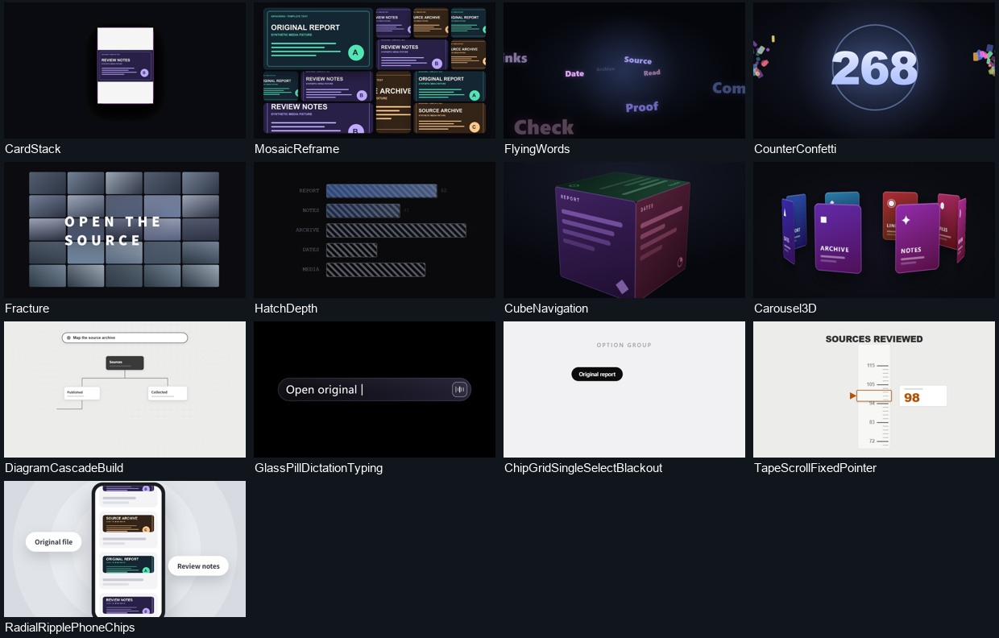

# aipacking 模板与实渲染

共 **122 个模板**。按台词选择镜头，填入本期文案、数据或素材。91 项随包渲染，31 项接入预先渲染的镜头。

## 实际渲染

[八镜合辑](assets/native-templates-3.2/scene-reel.mp4?raw=true) · [媒体与图解](assets/native-templates-3.2/motion-native-scenes.mp4?raw=true) · [两侧包装与章节轴](assets/native-templates-3.2/side-reel.mp4?raw=true) · [人物收窗与回位](assets/native-templates-3.2/overlay-focus.mp4?raw=true) · [关键词、清单、对比与总结](assets/native-templates-3.2/motion-kinetic.mp4?raw=true) · [叠加动效](assets/native-templates-3.2/overlay-cards.mp4?raw=true)

样片用合成素材、示例文案和演示数字展示镜头效果。

| 八镜合辑时间 | 模板 | 换入内容 |
| --- | --- | --- |
| 00:00 | 媒体拼墙重构 | 三种资料画面 |
| 00:06 | 级联节点图 | 检索指令、资料节点 |
| 00:11.3 | 立方体导航 | 六个资料分类 |
| 00:17.3 | 选项网格聚焦 | 五个选项与当前结果 |
| 00:22.3 | 网页聚焦 | 报告画面 |
| 00:27.3 | 前后图像对比 | 报告与复核记录 |
| 00:32.3 | 截图揭示 | 页面截图和状态文案 |
| 00:36.7 | 资料卡横移 | 三张资料卡和各自标题 |

[模板参数与编排方法](../skills/aipacking/references/native-templates.md)

## 文字、标题与字幕

| 模板 | 本期必填参数 |
| --- | --- |
| 描边文字回声 | `text` |
| 引语逐段高亮 | `items` |
| 逐字打字 | `text` |
| 文字逐段建立 | `text` |
| 重点文字划亮 | `highlight` |
| 文案保留与改写 | `headline`、`keep`、`append` |
| 选择关键文字 | `headline` |
| 前后文案替换 | `fromText`、`toText` |
| 词组汇聚 | `text` |
| 重点词轮换 | `headline`、`words` |
| 标题扫入 | `titles` |
| 字块拼合 | `text` |
| 字形轮换 | `lead`、`subject` |
| 开场短词推近 | `lead`、`rest`、`nextWord`、`words` |
| 跟读式字幕 | `text`、`emphasize` |
| 短句逐拍强调 | `script` |
| 文字揭示 | `text` |
| 文字放大强调 | `text` |
| 文字变形 | `lead`、`emphasis`、`morphTo`、`finally_` |
| 逐词字幕 | `srt` |
| 字标切入 | `word` |
| 飞入关键词 | `words` |
| 碎片聚合标题 | `text` |
| 胶囊输入框 | `text` |
| 关键词与解释 | `keyword`、`explanation` |
| 总结与行动 | `summary`、`action` |
| 模糊字转清晰 | `text` |
| 字幕轨 | `lines` |
| 重点语句标签 | `text` |
| 术语解释卡 | `term`、`def`、`en` |
| 文字切换 | `lines`、`draftTag` |
| 引语与署名 | `quote`、`author` |

## 步骤、对比与关系

| 模板 | 本期必填参数 |
| --- | --- |
| 路线节点 | `points`、`links` |
| 架构关系图 | `nodes`、`connections` |
| 逐项聚焦列表 | `label`、`items` |
| 行动号召卡 | `items` |
| 特性清单 | `title`、`features` |
| 产品时间线 | `title`、`milestones` |
| 评价卡 | `items` |
| 前后图像对比 | `images`、`labels` |
| 任务步骤与结果 | `query`、`steps`、`result` |
| 逐项核对 | `headline`、`words` |
| 成员与角色卡 | `label`、`rows` |
| 状态轮换 | `prefix`、`statuses`、`chips` |
| 列表逐项展开 | `title`、`subtitle`、`items`、`kicker` |
| 资料卡片滚动 | `items` |
| 级联节点图 | `prompt`、`labels` |
| 选项网格聚焦 | `labels`、`caption` |
| 要点清单 | `heading`、`points` |
| 双边对比与结论 | `heading`、`left`、`right`、`conclusion` |
| 流程卡片与消散 | `title`、`content`、`media` |
| 路径对比 | `title`、`content` |
| 环形关系图 | `title`、`content`、`media` |
| 章节进度 | `chapters` |
| 逐项勾选 | `title`、`items`、`checked` |
| 对象标签 | `chips`、`note` |
| 图钉板 | `title`、`subtitle`、`items`、`stepMs` |
| 步骤时间轴 | `title`、`steps`、`tagZh`、`nowZh` |
| 双卡对照 | `aKicker`、`aTitle`、`aSub`、`bKicker`、`bTitle`、`bSub`、`winner` |
| 人物收窗与回位 | `camSrc`、`camSize`、`eyebrow`、`items` |

## 数据与图表

| 模板 | 本期必填参数 |
| --- | --- |
| 数字滚入 | `value`、`label` |
| 面积图 | `items` |
| 柱状图 | `values`、`labels` |
| 数据表 | `columns`、`tableData` |
| 环形图 | `items` |
| 圆环进度 | `value`、`label` |
| 数字网格 | `from`、`to`、`noun` |
| 数字落定与彩屑 | `value` |
| 条纹深度对照 | `rows`、`heading` |
| 滚动刻度 | `title`、`from`、`to` |
| 增长曲线 | `kicker`、`kickerZh`、`points`、`unit`、`caption` |
| 滚动数字 | `kicker`、`value`、`unit`、`label` |
| 排名条 | `title`、`rows`、`suffix` |
| 环形指标 | `kicker`、`value`、`max`、`label` |
| 数字证据卡 | `kicker`、`kickerZh`、`value`、`suffix`、`footEn`、`footZh` |

## 界面操作与证据

| 模板 | 本期必填参数 |
| --- | --- |
| 对话消息 | `contact`、`messages` |
| 代码编辑器 | `code` |
| 终端操作 | `commands`、`outputs` |
| 网页聚焦 | `src` |
| 设备画框 | `src` |
| 光标巡览 | `xPositions`、`yPositions`、`src` |
| 答案高亮 | `question`、`answer`、`statement`、`word` |
| 终端命令演示 | `lines` |
| 逐段显示回答 | `question`、`answer`、`headline`、`model` |
| 按钮与完成状态 | `label`、`pending`、`done` |
| 截图揭示 | `headline`、`capturing`、`copied`、`src` |
| 对话串 | `messages` |
| 点击后输入 | `placeholder`、`prompt`、`hint` |
| 电脑画框 | `screenSrc`、`notchLabel` |
| 手机画框 | `screenSrc` |
| 指令发送 | `text`、`placeholder`、`chips` |
| 输入区聚焦 | `greeting`、`text`、`placeholder`、`model`、`effort` |
| 录屏展示 | `src` |
| 搜索输入 | `text`、`seed` |
| 立方体导航 | `labels` |
| 手机画面与径向扩散 | `imageUrls`、`labels` |
| 立体终端 | `file`、`lines` |
| 界面标注 | `label`、`hlWords` |

## 多素材展示与标志

| 模板 | 本期必填参数 |
| --- | --- |
| 图片轮播 | `images`、`labels` |
| 标志揭示 | `logoSrc`、`brand`、`tagline` |
| 图像铺开与标志 | `wordmark`、`tagline`、`images`、`logo` |
| 品牌轮播 | `lead`、`items` |
| 资料卡横移 | `heading`、`cards` |
| 多图汇聚与标志 | `wordmark`、`lines`、`images`、`captions`、`logo` |
| 标志收合 | `images`、`mark`、`wordmark`、`background` |
| 标志漂移 | `headline`、`tiles` |
| 标志闪切 | `brandName`、`logoSrc`、`images` |
| 参考图板揭示 | `leadIn`、`emphasis`、`tailIn`、`images`、`heroImage` |
| 球体群聚 | `script` |
| 环绕画廊 | `title`、`subtitle`、`buttonLabel`、`images` |
| 多手机叠放 | `videos`、`time` |
| 开场门框 | `lead`、`trail`、`title`、`brand` |
| 影像拼贴 | `topLine`、`bottomLine`、`swapTop`、`swapBottom`、`slides`、`collage` |
| 影像墙 | `videos` |
| 背景与标志组合 | `before`、`after`、`wordmark`、`logo`、`sky` |
| 卡片叠堆 | `imageUrls` |
| 媒体拼墙重构 | `imageUrls` |
| 立体轮播 | `labels` |
| 三维媒体墙 | `title`、`content`、`media` |
| 卡点蒙太奇 | `title`、`content`、`media` |
| 加速媒体网格 | `title`、`content`、`media` |
| 双媒体切换 | `title`、`content`、`media` |
