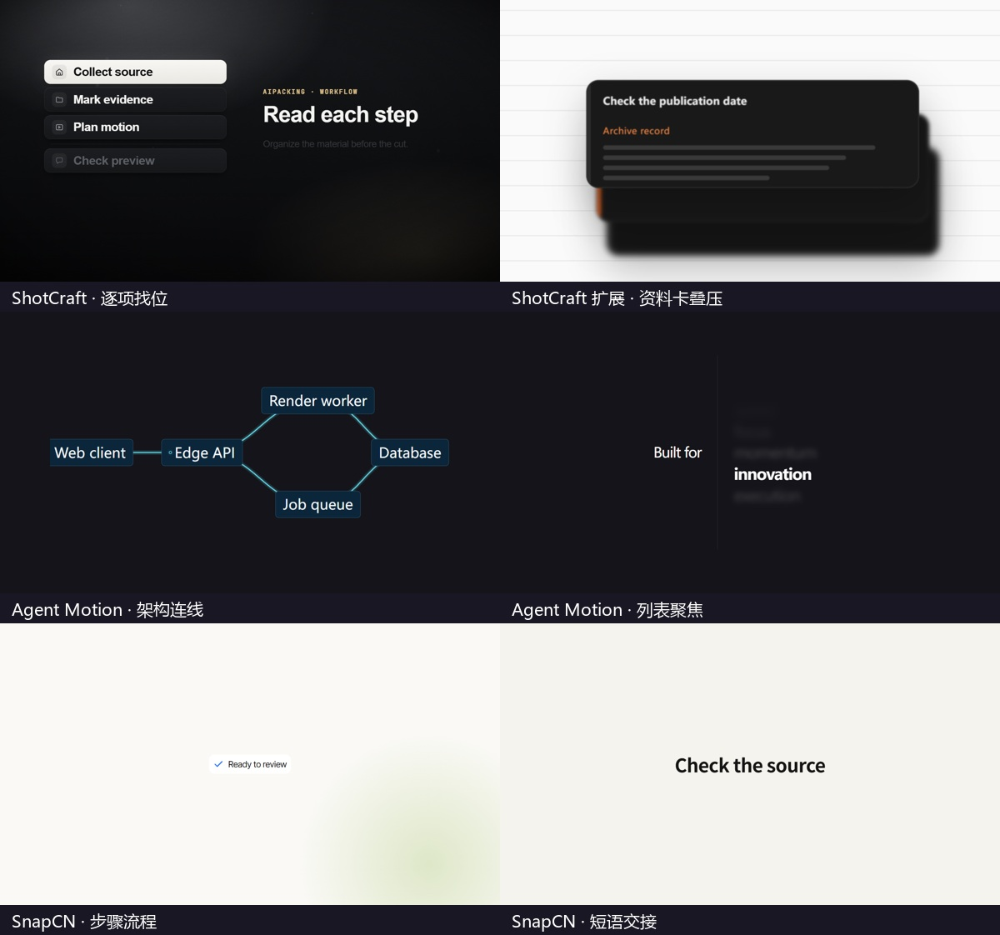

# aipacking 3.1 原版模板

下面的 33 项已接入 aipacking 的 Final 合成，并各自核对了中段实帧。完整动态合辑抽取六项。两类独立工程按原入口渲染，再按版式接回本片。

[看六镜合辑](assets/native-templates/native-showcase.mp4?raw=true) · [.Motion B1](assets/native-templates/motiongit-native-demo.mp4?raw=true) · [Overlay Studio VS 对撞](assets/native-templates/overlay-native-demo.mp4?raw=true)

| 合辑时间 | 原版镜头 |
| --- | --- |
| 00:00 | ShotCraft · List Reveal |
| 00:04 | ShotCraft 扩展镜头 · Research Card Stack Scroll |
| 00:08.8 | Agent Motion · Architecture Diagram |
| 00:13.8 | Agent Motion · Blur Focus List |
| 00:18.8 | SnapCN · Agent Steps |
| 00:24.1 | SnapCN · Text Swap |

## 实际接入方式

- **.Motion**。MotionGit 酷炫科技风 0.2.7-open-beta，用本期文字跑原版 B1 渲染，输出由 NativeRenderedClip 接回全屏。已核对本例；其余包依各自工程入口和素材合同选型。[原工程与许可](https://github.com/motiontemplates/385712)
- **Overlay Studio**。原版 versus-card 走其原导出脚本，交付透明 ProRes 4444。用 NativeOverlayLayer 叠到当前视频。这里的展示版在深底上合成。[原仓库与许可](https://github.com/jeszhou/overlay-studio)
- **ShotCraft 扩展批**。Research Card Stack Scroll 来自上游更新的镜头源码，归入扩展候选。用户所指独立扩展批仍需原始文件或清单核对。
- **SnapCN Word Flip**。原组件的测量未在本宿主释放渲染等待，待解决后再接入。

[.Motion 示例参数](assets/native-templates/motiongit-demo-input.json) · [Overlay Studio 示例编排](assets/native-templates/overlay-demo-input.json) · [合辑时间 JSON](assets/native-templates/chapters.json)

## 完整可调用 ID

| 来源 | 实际模板 ID | 版本 | 本期必填参数 |
| --- | --- | --- | --- |
| Agent Motion | AgentMotion_AnimatedCounter | 0.3.0 | value、label |
| Agent Motion | AgentMotion_AnimatedRouteMap | 0.3.0 | points、links |
| Agent Motion | AgentMotion_ArchitectureDiagram | 0.2.0 | nodes、connections |
| Agent Motion | AgentMotion_AreaChart | 0.2.0 | items |
| Agent Motion | AgentMotion_BarChart | 0.2.0 | values、labels |
| Agent Motion | AgentMotion_BlurFocusList | 0.2.0 | label、items |
| Agent Motion | AgentMotion_ChatConversation | 0.9.0 | contact、messages |
| Agent Motion | AgentMotion_CodeEditor | 0.1.0 | code |
| Agent Motion | AgentMotion_CtaCard | 0.3.0 | items |
| Agent Motion | AgentMotion_DataTable | 0.3.1 | columns、tableData |
| Agent Motion | AgentMotion_DonutChart | 0.3.0 | items |
| Agent Motion | AgentMotion_FeatureList | 0.2.0 | title、features |
| Agent Motion | AgentMotion_OutlineTextEcho | 0.13.0 | text |
| Agent Motion | AgentMotion_ProductTimeline | 0.1.1 | title、milestones |
| Agent Motion | AgentMotion_ProgressRing | 0.2.0 | value、label |
| Agent Motion | AgentMotion_QuoteHighlight | 0.1.0 | items |
| Agent Motion | AgentMotion_TerminalSession | 0.2.0 | commands、outputs |
| Agent Motion | AgentMotion_TestimonialCard | 0.1.0 | items |
| SnapCN | SnapCN_AgentSteps | 18b973d7592a | query、steps、result |
| SnapCN | SnapCN_AnswerHighlight | 18b973d7592a | question、answer、statement、word |
| SnapCN | SnapCN_TextBuild | 18b973d7592a | text |
| SnapCN | SnapCN_TextHighlight | 18b973d7592a | highlight |
| SnapCN | SnapCN_TextRewrite | 18b973d7592a | headline、keep、append |
| SnapCN | SnapCN_TextSelect | 18b973d7592a | headline |
| SnapCN | SnapCN_TextSwap | 18b973d7592a | fromText、toText |
| SnapCN | SnapCN_WordGather | 18b973d7592a | text |
| SnapCN | SnapCN_WordWheel | 18b973d7592a | headline、words |
| SnapCN | SnapCN_TitleSweep | 18b973d7592a | titles |
| SnapCN | SnapCN_CheckCycle | 18b973d7592a | headline、words |
| SnapCN | SnapCN_CountGrid | 18b973d7592a | from、to、noun |
| SnapCN | SnapCN_TerminalSimulator | 18b973d7592a | lines |
| ShotCraft | ShotCraft_ListReveal | 6700db2ba805 | title、subtitle、items、kicker |
| ShotCraft 扩展批 | ShotCraftExt_ResearchCardStackScroll | 6700db2ba805 | items |

[Agent Motion 源](https://agent-motion.com/) · [ShotCraft 源](https://github.com/Vincentwei1021/video-shotcraft) · [SnapCN 源](https://github.com/shadcn-labs/snapcn) · [生产参数与规则](../skills/aipacking/references/native-templates.md)
